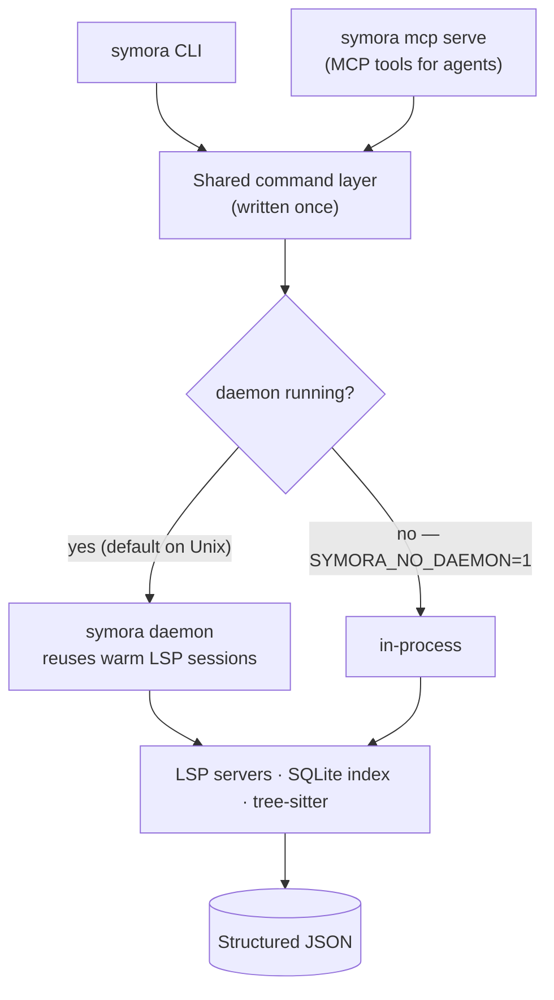
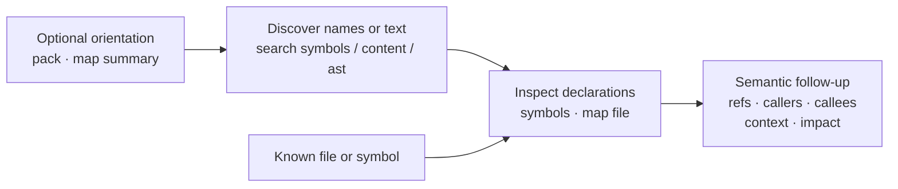

<picture>
  <source media="(prefers-color-scheme: dark)" srcset="assets/symora_black.png">
  <source media="(prefers-color-scheme: light)" srcset="assets/symora_white.png">
  
</picture>

# Symora

**Symbol-centric code intelligence for AI coding agents.** Symora combines language-server navigation, indexed search, and syntax analysis in a CLI and MCP server with structured JSON results.

[](https://github.com/junyeong-ai/symora/actions)
[](https://www.rust-lang.org)
[](https://github.com/junyeong-ai/symora)

**English** | [한국어](README.md)

---

## What is Symora?

Symora combines four engines for code exploration and editing:

- **LSP semantics** — real definitions, references, and call hierarchy from the same language servers your editor uses (rust-analyzer, pyright, typescript-language-server, gopls, and more).
- **SQLite symbol/content index** — persistent name/path and content search with ranked results.
- **tree-sitter AST search** — structural pattern matching, no language server required.
- **A reusable daemon** — keeps language-server sessions warm so repeated calls stay fast.

Every command prints JSON by default, so an agent or a shell script can parse the answer instead of re-reading files.

---

## Why Symora?

A coding agent (or a new teammate) needs declarations, references, and source context. Symora complements text search with structured answers:

| Question | Command |
| --- | --- |
| What's the shape of this repo? | `symora map summary` |
| Where is `processOrder` defined? | `symora search symbols processOrder` |
| What does this symbol do, in context? | `symora context <file:line> --all` |
| Who calls it? | `symora callers <file:line>` |
| Which static dependencies may be affected? | `symora impact <file:line>` |
| Preview a symbol edit | `symora edit replace-body … --dry-run` |

---

## Quick start

```bash
# 1. Install (prebuilt binary, SHA-256 verified)
curl -fsSL https://raw.githubusercontent.com/junyeong-ai/symora/main/scripts/install.sh | bash

# 2. Enter the project
cd your-project

# 3. Start with the scope you know
symora map summary                          # repo overview
symora context src/auth/service.ts:42 --body # inspect a known symbol
symora impact src/auth/service.ts:42        # blast radius of a change

# Optional: build an index for repeated name/content discovery; refresh after changes
symora search index build
symora search symbols AuthService           # find a symbol
```

LSP-backed commands also need the matching language server. Check with `symora doctor <lang>` and install with the command it prints.

Check `indexing`, `incomplete`, and `coverage_gaps` before treating results as complete. `indexing: "unconfirmed"` means workspace readiness could not be verified throughout the query; a small or empty reference set can still be partial.

---

## How it works

One command layer serves both CLI and MCP. Daemon and in-process execution share output contracts; language-server state and indexing can affect the observed results.



- **Two backends, different needs.** Index and `search ast`/`map` work with no language server. `symbols` and `map file` answer from the server's tree when one serves and from the compiled-in grammar when not, and say which in `backend` (`document` | `ast`). The other LSP-backed commands (`refs`, `callers`, `context`, `impact`, `rename`, …) need the server for the target language, and when a server lacks a capability they degrade *honestly* — a structured `unsupported` response, or a fallback that says it is one (`callers` without call hierarchy marks `callers_status: "references_derived"`) — never a silently-wrong answer.
- **The daemon is automatic.** On Unix, Symora keeps language-server sessions warm across invocations so the second call is fast. Set `SYMORA_NO_DAEMON=1` to run in-process; a sandbox that cannot write the daemon directory (`~/.symora`) runs in-process on its own. The answers are the same either way.

---

## The exploration flow

Symora is designed to narrow exploration from repository orientation to specific declarations and their relationships:



The walkthrough below follows exactly this path.

---

## Walkthrough — landing in an unfamiliar codebase

Say you just cloned **`shopflow`**, a TypeScript e-commerce backend you've never seen, and your task is *"add an empty-cart guard to checkout."* Here's the whole loop. (Examples use a fictional project; the JSON shapes are exactly what Symora emits.)

### ① Orient — what is this repo?

```bash
symora map summary
```
```json
{
  "root": "/home/dev/shopflow",
  "next_commands": [
    "symora map file --related-limit 5 -- 'src/main.ts'",
    "symora pack --tokens 4000 --focus='src'",
    "symora symbols --depth 1 -- 'src/main.ts'"
  ],
  "total_files": 84,
  "code_files": 67,
  "support_files": 17,
  "test_files": 18,
  "directories": 12,
  "languages": [
    { "language": "typescript", "file_count": 67, "test_files": 18 }
  ],
  "top_directories": {
    "count": 2,
    "showing": 2,
    "items": [
      { "path": "src", "file_count": 49, "test_files": 0 },
      { "path": "tests", "file_count": 18, "test_files": 18 }
    ]
  },
  "entrypoints": {
    "count": 2,
    "showing": 2,
    "items": [
      { "file": "src/main.ts", "reason": "main entry file" },
      { "file": "src/app.ts", "reason": "application bootstrap candidate" }
    ]
  }
}
```
> 49 of the 67 TypeScript code files live under `src`. `entrypoints` suggests starting points from file names and paths; confirm execution paths in source and configuration. `languages` counts code languages only; data files such as JSON are `support_files`. `symora pack --tokens 4000` gives a deeper brief ranked by PageRank over syntax-derived import paths when you want one.

### ② Discover — where is checkout handled?

```bash
symora search symbols processOrder
```
```json
{
  "count": 1,
  "showing": 1,
  "items": [
    {
      "name": "processOrder",
      "name_path": "CheckoutService/processOrder",
      "kind": "method",
      "file": "src/services/checkout.ts",
      "line": 48,
      "column": 9,
      "container": "CheckoutService",
      "backend": "index",
      "score": 1.0
    }
  ]
}
```
> Found it: `CheckoutService/processOrder` at `src/services/checkout.ts:48`. Every list response shares the same shape — `count` (total), `showing` (emitted), `items`.

### ③ Understand it in context

One call gathers the body, references, callers, callees, related types, and tests:

```bash
symora context src/services/checkout.ts:48 --all
```
```json
{
  "target": {
    "name": "processOrder",
    "kind": "method",
    "file": "src/services/checkout.ts",
    "line": 48,
    "signature": "async processOrder(cart: Cart, user: User): Promise<Order>",
    "body": "  async processOrder(cart: Cart, user: User): Promise<Order> {\n    const reserved = await this.inventory.reserve(cart.items);\n    const order = await this.payment.charge(user, cart.total);\n    return this.orders.create(order, reserved);\n  }"
  },
  "refs":    { "total": 5, "test": 3, "prod": 2, "files": 3, "modules": 3, "is_exported": false, "indexing": "unconfirmed" },
  "callers": { "count": 4, "showing": 4, "indexing": "unconfirmed", "items": [ /* handleCheckout, runOrderQueue, two test functions */ ] },
  "callees": { "count": 3, "showing": 3, "indexing": "unconfirmed", "items": [ /* reserve, charge, create */ ] },
  "types":   { "count": 1, "showing": 1, "indexing": "unconfirmed", "items": [ /* Order */ ] },
  "tests":   { "count": 2, "showing": 2, "items": [ /* processesAnOrder, processesTwice */ ] }
}
```
> You now see the implementation, its 5 references across 3 files (3 of them in tests), and the 2 tests that call it — without opening a single file. `is_exported` reads a TypeScript declaration's own `export`, so a class method is `false`. It does not establish accessibility through enclosing types, modules, or re-exports; an undetermined value is omitted. `"indexing": "unconfirmed"` marks each section a language server answered before Symora could confirm its workspace analysis had finished; typescript-language-server reports no such readiness, so its counts are lower bounds.

### ④ Who calls it?

```bash
symora callers src/services/checkout.ts:48
```
```json
{
  "count": 4,
  "showing": 4,
  "indexing": "unconfirmed",
  "items": [
    {
      "name": "handleCheckout",
      "location":  { "file": "src/routes/checkout.ts", "line": 23, "column": 23 },
      "call_site": { "file": "src/routes/checkout.ts", "line": 31, "column": 31 }
    },
    {
      "name": "runOrderQueue",
      "location":  { "file": "src/jobs/orderWorker.ts", "line": 67, "column": 23 },
      "call_site": { "file": "src/jobs/orderWorker.ts", "line": 72, "column": 19 }
    },
    {
      "name": "processesAnOrder",
      "location":  { "file": "tests/checkout.test.ts", "line": 8, "column": 23 },
      "call_site": { "file": "tests/checkout.test.ts", "line": 9, "column": 17 }
    },
    {
      "name": "processesTwice",
      "location":  { "file": "tests/checkout.test.ts", "line": 13, "column": 23 },
      "call_site": { "file": "tests/checkout.test.ts", "line": 14, "column": 17 }
    }
  ]
}
```
> Two production entry points — the HTTP route and a background job — and two test functions. `location` is where the caller is declared; `call_site` is the exact line that calls your symbol.

### ⑤ Which static dependencies may be affected?

```bash
symora impact src/services/checkout.ts:48 --depth 2
```
```json
{
  "target": { "name": "processOrder", "kind": "method", "file": "src/services/checkout.ts", "line": 48 },
  "refs": { "total": 5, "test": 3, "prod": 2, "files": 3, "modules": 3, "is_exported": false, "indexing": "unconfirmed" },
  "coverage": { "count": 3, "files": ["tests/checkout.test.ts"] },
  "blast_radius": {
    "direct_callers": 4,
    "transitive_callers": 7,
    "depth": 2,
    "max_depth_reached": true,
    "indexing": "unconfirmed",
    "dynamic_dispatch": { "status": "unavailable", "implementations": 0 },
    "callers_by_depth": [
      { "depth": 1, "count": 4, "test": 2, "prod": 2 },
      { "depth": 2, "count": 3, "test": 1, "prod": 2 }
    ],
    "test_caller_ratio": 0.43
  },
  "next_commands": ["symora impact --depth 3 -- 'src/services/checkout.ts:48:9'"],
  "files": [
    { "file": "tests/checkout.test.ts",  "is_test": true,  "refs": 3 },
    { "file": "src/jobs/orderWorker.ts", "is_test": false, "refs": 1 },
    { "file": "src/routes/checkout.ts",  "is_test": false, "refs": 1 }
  ]
}
```
> `test_caller_ratio` describes the discovered callers; it does not measure executed test coverage. With `max_depth_reached: true`, the transitive count is a lower bound. `dynamic_dispatch` qualifies a dynamically dispatched method: `incomplete` when the implementation lookup found overrides (`implementations` counts them) whose callers the counts leave out, `unavailable` when it could not establish them (`implementations` is absent when the lookup failed). Either way, callers reached through an override may be missing. Static references and call graphs do not prove runtime dispatch, external consumers, or configuration-based connections. Assess this evidence and its limits rather than an arbitrary risk or confidence score. `--depth 3` expands the graph by one level.

### ⑥ Make the change — preview before you write

```bash
symora edit replace-body src/services/checkout.ts --symbol 'CheckoutService/processOrder' \
  --body "$(cat new_processOrder.ts)" --dry-run
```
```json
{
  "operation": "replace_body",
  "file": "src/services/checkout.ts",
  "target_symbol": "CheckoutService/processOrder",
  "target_kind": "method",
  "lines": { "start": 48, "end": 52 },
  "bytes_changed": 61,
  "dry_run": true,
  "preview": "@@ -48,5 +48,6 @@\n-  async processOrder(cart: Cart, user: User): Promise<Order> {\n-    const reserved = …\n …\n+  async processOrder(cart: Cart, user: User): Promise<Order> {\n+    if (cart.items.length === 0) throw new EmptyCartError();\n+    const reserved = …\n …"
}
```
> `--dry-run` shows the whole span it would replace (every old line `-`, every new line `+`) and the net byte change, and writes nothing. The span is the one `symbols --body` returns, decorator, attribute and doc-comment lines included, so a body read there, changed and passed back keeps them. Drop `--dry-run` to apply, or add `--verify-callers` to pull diagnostics on the files that reference the symbol afterward. Prefer `--symbol` over a line number — it re-resolves against the live file, so sequential edits don't go stale.

Source edits serialize project writers and reject changes to the content they read. For a file the language server has not opened, Symora cannot verify that the server computed its edit against the current text. File replacement is atomic; a multi-file operation is not a transaction across files. Avoid concurrent external editing and review any applied files named in an error.

> **Addressing is forgiving but safe.** `--symbol` matches a bare name, a `Class/method` suffix, a `*/method` wildcard, or the exact `name_path`, and a trailing `[kind]` selects one kind among same-named declarations (`Svc[class]` rather than its constructors). A segment written wholly in brackets is a name, as a computed member's is (`Cache/[key]`). When a name is ambiguous, `edit` refuses rather than guess, and lists where each candidate is declared:
> ```json
> { "error": { "code": "invalid_argument",
>   "message": "Symbol path 'reserve' matches 2 symbols in src/services/inventory.ts",
>   "hint": "Candidates: InventoryService/reserve (method) at src/services/inventory.ts:34:3, ReservationPool/reserve (method) at src/services/inventory.ts:88:3. Target one by its location instead." } }
> ```

---

## Command groups

```bash
# Discovery (index, AST, and live workspace lookup)
symora search symbols AuthUser              # ranked name/path search
symora search symbols AuthUser --workspace-symbols   # force live LSP, skip the index
symora search symbols AuthUser --path src/auth      # only symbols declared in these files/directories
symora search symbols 'CheckoutService/processOrder' --body   # a declaration's source without knowing its file
symora search content "async function"      # ranked full-text search
symora search ast '(class_declaration) @c' --lang typescript   # structural AST match
symora pack --tokens 4000                   # token-budgeted, PageRank-ranked repo brief

# Project & file overview
symora map summary                          # repo shape
symora map file src/services/checkout.ts    # one file: symbols, siblings, related files

# Symbols & inspection (LSP or AST declarations; semantic queries require LSP)
symora symbols src/services/checkout.ts --depth 2   # declarations two levels deep
symora symbols src/services/checkout.ts --body      # tree + source bodies
symora symbols src/services/checkout.ts --depth 1 --refs   # reference counts per declaration and member
symora symbols src/services/checkout.ts --symbol 'CheckoutService/processOrder'
symora def src/services/checkout.ts:48:9            # go to definition
symora hover src/services/checkout.ts:48:9          # type / signature

# Navigation (LSP)
symora refs src/services/checkout.ts:48             # references; inspect indexing
symora callers src/services/checkout.ts:48          # incoming calls
symora callees src/services/checkout.ts:48          # outgoing calls
symora callees src/services/checkout.ts:48 --depth 3            # reachable set
symora callees src/services/checkout.ts:48 --to src/db/orders.ts:12   # shortest call chain
symora typedef … / implementations … / supertypes … / subtypes …

# Context & impact (LSP)
symora context src/services/checkout.ts:48 --all    # body + refs + callers + callees + types + tests
symora context src/services/checkout.ts:48 --callees --types --with-bodies   # with callee and type bodies
symora impact src/services/checkout.ts:48           # change blast radius
symora diff-impact                                  # impact of the working tree's changes against HEAD, staged or not
symora diff-impact $(git merge-base main HEAD)      # impact of what this branch changed (a range A..B is refused)

# Edit & refactor (mutations preview with --dry-run)
symora edit replace-body <file> --symbol 'Class/method' --body "$(cat new.ts)" --dry-run
symora edit insert-before <file> --symbol 'Class/method' --code "// note"
symora edit insert-after  <file> --symbol 'Class/method' --code "// note"
symora edit delete        <file> --symbol 'Class/method' --expect-no-references
symora edit replace       <file>:10 --end <file>:12 --text "new lines"
symora edit pattern       <file> --pattern '(function_item) @f' --lang rust --text "…"
symora rename src/services/checkout.ts:48:9 settleOrder --dry-run
symora actions list src/services/checkout.ts:48:9   # available code actions

# Health & diagnostics
symora doctor                # language servers: verified serving / missing + install commands
symora diagnostics src/services/checkout.ts --with-context --with-suggestions
```

Global flags work before or after the subcommand: `symora --format pretty search symbols X` (indented JSON), `symora -q rename …` (errors only), `symora -v doctor` (verbose). `--deterministic` and `--check-version <REQ>` are global too. `--deterministic` never consults a language server: it answers from the index, the compiled-in grammars, and file scans, so the answer does not depend on which servers are installed, and a command that needs a server fails with `unsupported`. `--check-version` refuses to run unless this binary satisfies the requirement (`0.35`, `>=0.35,<0.36`), so a caller that parses the output never has to compare `--version` strings itself.

---

## The output contract

Every command is built for machine parsing, and the rules are stable:

- **List responses** share one shape: `count` (total found), `showing` (emitted), `items`, plus — only when relevant — qualifiers such as `truncated`, `stale`, `incomplete`, `indexing`, `coverage_gaps`, `unread_paths`, `hints`, and `next_commands`. Fields that qualify a list come before the lists they qualify, so a reader that keeps only the head of a response still has them.
- **Command failures** are structured JSON and exit non-zero:
  ```json
  { "error": { "code": "server_not_installed", "message": "…", "hint": "…" } }
  ```
  `code` and `message` are always present; `hint` only when there's an actionable next step. Common `code` values: `not_found`, `invalid_argument`, `unsupported`, `conflict`, `precondition_failed`, `server_not_installed`, `lsp_unavailable`, `timeout`, `cancelled`. A bad CLI argument arrives in the same envelope — `invalid_argument`, as JSON rather than clap's prose — so parsing one stream, stdout, covers every failure. One thing sits outside: a clean "nothing found" (e.g. `def` on a position with no definition) is `{ "message": … }` at exit 0 — absence is not an error.
- **Positions are 1-indexed** on both input and output, and an explicit `file:line:column` means one thing on every command. Symbol-level commands (`refs`, `callers`, `callees`, `implementations`, `supertypes`, `subtypes`, `context`, `impact`) take a column-less `file:line`, which addresses the symbol declared on that line (a body line falls back to the enclosing symbol), or a `file:line:column`, which is precise: on a symbol's name it means that symbol, elsewhere it means the token there — a call site resolves through its definition to the symbol called, exactly what `def`, `hover`, and `rename` read at the same position. `def`, `hover`, `typedef`, and `rename` read an omitted column as column 1. `edit` addresses declarations only: a column must sit on one. Navigation location objects carry line and column. Summary targets such as those in `context` and `impact` carry file and line without a column.
- **Degradation is disclosed, never hidden.** `incomplete: true` means the count itself is a lower bound — the answer does not hold everything its own sources held; the leading `hints` name the cause, and `next_commands` carries the fix where one exists. When the cause is a path that could not be read, `map`, `pack`, and `search index status` name those paths directly in `unread_paths` — check their permissions, since no rebuild reaches a path nothing can read. `stale` describes index currency, `indexing` qualifies language-server readiness, and `incomplete` describes enumeration within the consulted sources. `coverage_gaps` lists languages that couldn't be searched, and an `unsupported` error names the missing capability — the server's, or an edit shape Symora does not apply — and points to an alternative.
- **Output format** is indented JSON when stdout is a terminal and single-line JSON when it is a pipe or file; `--format pretty|compact` fixes it. Responses declaring `budget_tokens` use their command budget. Other responses target `output.max_response_chars` (default 20,000; 0 disables). Source bodies are omitted whole before list items, with `body_omitted: "response_size"`, preserving declaration identity. A list cut to fit keeps its `count`, sets `truncated`, and adds a hint naming `output.max_response_chars`. Fixed metadata may exceed the target. Compact serialization determines fitting regardless of display format.

`pack --tokens` uses a character-based approximation. It does not bound model-specific token counts or the entire JSON envelope.

Requested `context` bodies share `--body-tokens` in target/callee/type order, whole-body-or-nothing; `body_omitted: "token_budget"` discloses budget omissions. Pack provides syntax-derived orientation and discloses unsupported import languages; module strings requiring unsupported decoding are omitted. A non-relative JavaScript or TypeScript specifier resolves through the nearest `tsconfig.json` (or `jsconfig.json`) `paths` and `baseUrl`, with what it extends by a relative path; one a `paths` alias matches that names no file pack reads is disclosed in a hint. Rust paths relative to a module (`self::`, `super::`, a module the file declares) and `crate::` paths from a file whose crate root the Cargo layout does not determine are omitted without module ownership, with a hint when encountered; a project library's name resolves through its `Cargo.toml`, and an external crate names no project file. An unmatched `--focus` is refused.

`lsp.timeout_secs` is the shared LSP work budget for one command. Startup, requests, and retries consume it together, and daemon RPCs carry the remaining allowance. It does not interrupt source application midway.

Results carry `indexing: "unconfirmed"` unless workspace readiness is confirmed throughout the query. Log text, ended progress tasks, and elapsed time do not prove completion. A zero in this state does not prove absence. Rename refuses application under `unconfirmed` and `timed_out`, and `--dry-run` previews the current edit set. `--accept-unconfirmed` applies a reviewed `unconfirmed` set and keeps the marker in the response; `timed_out` stays refused, since a retry may still confirm readiness. Of the supported servers, only rust-analyzer sends a readiness signal Symora recognizes (its healthy quiescent status). Servers without a supported readiness signal, including default Pyright, remain unconfirmed even when their previews look complete.

---

## Search index

Symora keeps a persistent SQLite index at `.symora/store.db` in each project. The `.gitignore` it writes in `.symora/` keeps the index, its caches and locks out of commits, while a `config.toml` or `ignore` kept there stays committable.

The index is a snapshot of the last build. Currency checks compare the file-size policy, paths, sizes, and modification times; rebuild after changes preserving that metadata. A list's `stale` flag marks rows read from files changed since the build; no row can reveal a file the build never saw. Results the index answered, empty ones included, also carry currency hints naming the languages whose files changed since the build, with `symora search index build` in `next_commands`.

```bash
symora search index build               # incremental: only changed files, prunes deleted
symora search index build --force --lang rust
symora search index status              # languages covered, symbol/file/line counts, size, last_indexed
symora search index clear
```

Search degrades gracefully without an index (it falls back to a filesystem scan or live LSP), but a built index is the fastest, most reliable path for repeated use. `--force` is only for a full rebuild.

---

## Configuration

Precedence: `.symora/config.toml` → `~/.config/symora/config.toml` (honors `XDG_CONFIG_HOME`) → built-in defaults. Two environment overrides sit above the files: `SYMORA_SEARCH_LIMIT` and `SYMORA_LSP_TIMEOUT`.

`[daemon]` settings apply to the entire daemon and are read only from the user config. Keys under `[daemon]` in a project config are ignored and reported in `config_errors`. The daemon reads these settings once at startup, so run `symora daemon restart` to apply changes.
`idle_timeout_mins` sets how long a project and each language server remain alive after their last request finishes. The daemon itself exits once it has gone that long with no project and no request, and the next command starts it again.

```bash
symora config init            # project config listing every default, commented out
symora config init --global   # the same for the user config
```

Common settings: LSP timeouts and limits, daemon behavior, test-file patterns, and per-language server overrides:

```toml
[lsp.servers.typescript]
command = "/Users/me/.nvm/versions/node/v20.11.0/bin/typescript-language-server"
args = ["--stdio"]   # optional; absent = inherit built-in args
tier = "slow"        # optional; one of fast | standard | slow
env = { NODE_OPTIONS = "--max-old-space-size=2048" } # optional; server environment variables
```

Entries in `env` are added to the server's inherited environment. For example, you can set the heap limit of a Node-based server such as pyright with `NODE_OPTIONS = "--max-old-space-size=2048"`.

Per-server `initialization_options` supplies LSP initialization options; `settings` supplies runtime configuration. Each object merges recursively into its respective defaults; arrays and scalar values replace defaults. Settings are sent immediately after initialization and returned through `workspace/configuration`. Nested keys follow the language server's own configuration schema.

```toml
[lsp.servers.python.settings.python]
pythonPath = "/path/to/project/.venv/bin/python"

[lsp.servers.python.settings.python.analysis]
extraPaths = ["packages/core/src"]
```

Prepare the project's environment or native server configuration first. These paths are explicit examples; Symora does not infer package paths. A project override replaces the entire user-level stanza for that language.

`symora doctor python` reports the interpreter setting a fresh server will receive in `python_interpreter`: explicit `settings`, a discovered `project_environment`, or `server_default` when selection is left to the server. `serves` only confirms the LSP handshake; neither field verifies imports or reference completeness. A retained daemon session needs project restart to pick up changed settings or a newly prepared environment.

The key is the `language` id printed by `symora doctor`. A rejected key is reported in `config_errors` and never silently applied. The daemon reads a project's config when it first serves that project and retains it until the project is unloaded. After editing it, run `symora daemon restart --project`; the next request starts that project's servers with fresh settings. Other projects keep their sessions; active requests or pending server startup make the restart return `conflict`. This does not reset the persistent index or confirm workspace indexing completeness.

File discovery follows the project's `.gitignore` (root and nested, with full per-directory semantics), plus an optional `.symora/ignore` — gitignore syntax — for symora-only exclusions. When a project ships no root `.gitignore`, common dependency and build directories (`node_modules`, `target`, `dist`, …) are skipped by default. Machine-local git state — `.git/info/exclude` and the global `core.excludesFile` — is not read, so the same tree indexes the same way on every machine. Default discovery excludes hidden entries, independently of `.gitignore`. `search content 'text' --path .claude` explicitly searches a named file/directory live, including hidden text and documentation formats; `search ast --path` reads hidden files inside the named paths the same way. Project ignores and size limits still apply: a `--path` the ignore rules exclude is refused, and `.git` and `.symora` remain excluded. Explicit paths do not widen the persistent index.

---

## Installation

One-shot install — no prompts. Downloads the prebuilt binary (SHA-256 verified, source build where no prebuilt exists) and installs the Claude Code skill:

```bash
curl -fsSL https://raw.githubusercontent.com/junyeong-ai/symora/main/scripts/install.sh | bash
```

Useful variants:

```bash
# Binary only, skip the Claude Code skill
curl -fsSL .../install.sh | bash -s -- --no-skill

# Pin a release / verify GitHub build provenance (needs a logged-in gh CLI — it asks the attestations API)
curl -fsSL .../install.sh | bash -s -- --version <version> --verify-attestations

# Source build (builds the release tag from git; no checkout needed)
curl -fsSL .../install.sh | bash -s -- --source

# Guided prompts (method, skill) — works even piped through curl
curl -fsSL .../install.sh | bash -s -- --interactive

# Change install location
curl -fsSL .../install.sh | SYMORA_INSTALL_DIR=/usr/local/bin bash
```

Prebuilt targets: macOS Apple Silicon, Linux x86_64 (gnu), Linux aarch64 (gnu). Platforms without a prebuilt (Intel Macs, etc.) fall back to a source build automatically (requires Rust). Inside a checkout, `cargo install --path .` works too.

The binary owns the rest of its lifecycle:

```bash
symora setup                          # interactive: skill + language servers
symora setup skill                    # skill only
symora setup deps --group core        # dependencies only (core / core-jvm / core-web / core-systems / all)
symora self update                    # in-place upgrade to the latest release
symora self update --version <version>
symora self update --verify-attestations   # refuse to install without gh
symora self uninstall                 # remove binary + skill + config + daemon data (MCP entries stay — run `symora setup mcp --uninstall` first)
```

An update always verifies the SHA-256, and when `gh` is installed it also verifies build provenance against the attestation bundle published with the release. Reading the bundle from a file means `gh` needs no login. With `gh` installed, a release that publishes no bundle is refused — the checksum is produced by whoever produced the archive, so it says nothing about origin. Releases from v0.21.0 onward publish a bundle; use `scripts/install.sh` to install an earlier release.

---

## MCP server

Symora also runs as a Model Context Protocol server. A curated subset of commands — navigation, analysis, and edit tools — is exposed as MCP tools that share the same in-process command layer, so the MCP and CLI results match.

```bash
symora setup mcp                     # auto-detect and wire installed hosts (Claude Code: this project's .mcp.json, Codex: ~/.codex/config.toml)
symora setup mcp --dry-run           # show the plan without writing
symora setup mcp --host claude_code  # a specific host only
symora setup mcp --uninstall         # disconnect (removes only the entry it wrote)

symora mcp serve                                 # stdio (Claude Code, Cursor, etc.)
symora mcp serve --transport http --port 7700    # HTTP

symora mcp tools                                 # tool catalog as JSON (schemas and mutation annotations)
symora mcp tools --profile read-only             # what a read-only server would expose
```

`mcp tools` prints the same catalog `tools/list` serves, so a machine-readable capability inventory is available without starting a server — input schemas on every tool, output schemas on the tools that declare one, and a tool's output schema also describes the JSON the matching CLI command emits. Tools that write are marked twice — the word `Mutates` in the description and `annotations.readOnlyHint: false` — and every one that edits source supports `dry_run` (`build_index`, which only rebuilds the index, does not). The official Rust MCP SDK handles negotiation, transport, and cancellation. Both the 2026-07-28 per-request metadata flow and earlier initialize flows are supported. HTTP binds to loopback only; put remote access behind an authenticated proxy.

---

## For AI agents

The agent-facing playbook ships *with the tool*, not in this README, so it stays in lockstep with the binary:

- `symora setup skill` installs the skill bundled into the binary without network access. An explicit `--git-ref` uses only that source and never falls back to another version on failure.
- `symora mcp serve` exposes instructions for tool sequencing, result limits and error recovery through the metadata flow supported by the connected client.

For a known file or declaration, go directly to `symbols`, `context`, `refs`, or `impact`. Use `map summary` and `pack` when repository orientation helps. List responses share one shape; positions are 1-indexed; command failures, including bad CLI arguments, are structured `{code, message, hint}` at non-zero exit.

---

## Platform notes

- **Linux** and **macOS**: supported.
- **Windows**: no prebuilt binary and no CI coverage. The daemon speaks over a Unix domain socket, so every command runs in-process.

On Unix the daemon is on by default (`SYMORA_NO_DAEMON=1` forces in-process). The mode is chosen once at startup — there is no runtime fallback. `daemon start` and `daemon restart` return once the daemon actually answers, so a success response means it is serving. Concurrent commands meeting a cold start bring up exactly one daemon. Each installation (executable path) runs its own daemon, so versions pinned per repository do not replace each other's daemon.

```bash
symora daemon start | stop | restart | status
```

---

## Command reference

Run `symora <command> --help` for any command's flags. Output fields are described in [the output contract](#the-output-contract) and in the output schemas `symora mcp tools` prints.

---

## Troubleshooting

| Symptom | Fix |
| --- | --- |
| `count: 0` from `search …` | Check `symora search index status` and the response's hints and `coverage_gaps`. An empty `languages` means no symbol build has completed — run `symora search index build`. A path query (`Class/method`, `Name[kind]`), a name the index does not match, and a language the index does not cover consult a language server; content search scans files. `--deterministic` never consults a language server. |
| `server_not_installed` | `symora doctor <lang>` and install per its `install` field, or point `[lsp.servers.<lang>]` at an existing binary, then `symora daemon restart --project`. `installed: true` with `serves: false` means the binary resolves but does not run — usually a version-manager shim; run it directly to see why. Changes to the daemon's inherited environment require a full `symora daemon restart`. |
| `coverage_gaps` on a search | That language is missing from the answer. With `reason: "unavailable"`, `message` carries the failure's first line (for a server that rejected `initialize`, its reason), and the hints and `next_commands` lead with the languages whose lookup failed. |
| `indexing: "timed_out"` / `"unconfirmed"` | Workspace readiness was not confirmed for the query. List counts may be partial; an empty `def` or `hover` result does not prove absence. Retry after pending server work finishes, but a server without a supported readiness signal stays unconfirmed. `rename` refuses application; inspect the edit set with `--dry-run`, then apply an `unconfirmed` one with `--accept-unconfirmed`. |
| `incomplete: true` | The count is a lower bound — the answer does not hold everything its own sources held. The leading `hints` name the cause; `next_commands` carries the fix where one exists. If `unread_paths` came with it, check those paths' permissions — no rebuild reaches a path nothing can read. |
| `conflict` from `edit`/`rename` | The file changed since it was analyzed — re-read it and retry with fresh coordinates. Recoverable. |
| `conflict` from `search index` | Another process is rebuilding the index — retry as-is; nothing is left half-applied. |
| Stale results after edits | Index rows (`backend: "index"`) in a list marked `stale: true` are a snapshot of the last build — `symora search index build` (incremental). LSP-backed answers follow edits: the daemon and `mcp serve` watch the project and pass on-disk changes to the language servers. On Linux a directory the watch cannot cover (unreadable, or past `fs.inotify.max_user_watches`) is skipped, and changes under it show once its watch restarts: `symora daemon restart --project`, or the `mcp serve` process itself under `SYMORA_NO_DAEMON=1`. |
| Debugging | `symora -v <command>` for verbose logs. |

---

## Links

- [Developer guide](CLAUDE.md)
- [GitHub repository](https://github.com/junyeong-ai/symora)

---

<div align="center">

**English** | [한국어](README.md)

Made with Rust 🦀

</div>
