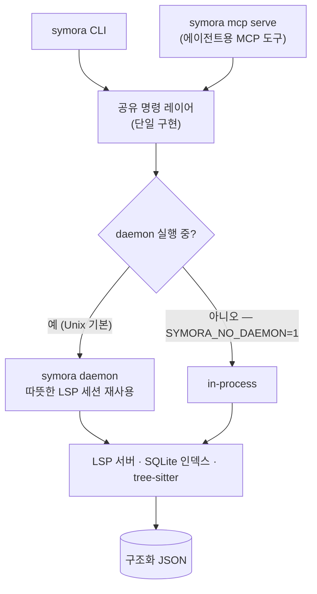
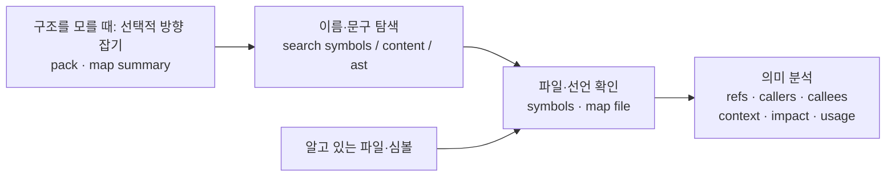

<picture>
  <source media="(prefers-color-scheme: dark)" srcset="assets/symora_black.png">
  <source media="(prefers-color-scheme: light)" srcset="assets/symora_white.png">
  
</picture>

# Symora

**AI 코딩 에이전트를 위한 심볼 중심 코드 분석 도구.** Symora는 language server 탐색, 인덱스 검색, 구문 분석을 CLI와 MCP 서버로 제공하며 구조화된 JSON을 반환합니다.

[](https://github.com/junyeong-ai/symora/actions)
[](https://www.rust-lang.org)
[](https://github.com/junyeong-ai/symora)

[English](README.en.md) | **한국어**

---

## Symora란?

코드 탐색과 수정을 위해 네 가지 엔진을 결합합니다.

- **LSP 의미 분석** — 에디터가 쓰는 바로 그 language server(rust-analyzer, pyright, typescript-language-server, gopls 등)에서 실제 정의·참조·호출 계층을 가져옵니다.
- **SQLite 심볼/콘텐츠 인덱스** — 저장소의 심볼과 콘텐츠를 검색하며, 디스크에 지속됩니다.
- **tree-sitter AST 검색** — language server 없이 구조적 패턴 매칭.
- **재사용 daemon** — language server 세션을 따뜻하게 유지해 반복 호출을 빠르게.

모든 명령은 기본적으로 JSON을 출력하므로, 에이전트나 셸 스크립트가 파일을 다시 읽는 대신 답을 바로 파싱할 수 있습니다.

---

## 왜 Symora인가?

코딩 에이전트(또는 새로 합류한 팀원)는 선언, 참조, 소스 맥락이 필요합니다. Symora는 텍스트 검색을 보완하는 구조화된 답을 제공합니다.

| 질문 | 명령 |
| --- | --- |
| 이 저장소의 구조는? | `symora map summary` |
| `processOrder`는 어디 정의돼 있지? | `symora search symbols processOrder` |
| 이 심볼은 맥락 속에서 뭘 하지? | `symora context <file:line> --all` |
| 누가 호출하지? | `symora callers <file:line>` |
| 변경에 영향을 받을 수 있는 정적 의존성은? | `symora impact <file:line>` |
| 심볼 수정 미리보기 | `symora edit replace-body … --dry-run` |

---

## 빠른 시작

```bash
# 1. 설치 (사전 빌드 바이너리, SHA-256 검증)
curl -fsSL https://raw.githubusercontent.com/junyeong-ai/symora/main/scripts/install.sh | bash

# 2. 프로젝트로 이동
cd your-project

# 3. 알고 있는 범위부터 탐색
symora map summary                          # 저장소 개요
symora context src/auth/service.ts:42 --body # 알고 있는 심볼 확인
symora impact src/auth/service.ts:42        # 변경 영향 범위

# 선택: 이름·콘텐츠를 반복 검색할 때 인덱스 빌드, 소스 변경 후 증분 갱신
symora search index build
symora search symbols AuthService           # 심볼 찾기
```

LSP 기반 명령은 해당 언어의 language server가 필요합니다. `symora doctor <lang>`로 확인하고, 출력에 나온 명령으로 설치하세요.

결과를 완전한 목록으로 취급하기 전에 `indexing`, `incomplete`, `coverage_gaps`를 확인하세요. `indexing: "unconfirmed"`는 요청 전체에 걸쳐 워크스페이스 준비 상태를 확인할 수 없었다는 뜻이며, 참조가 적거나 없어도 일부 결과일 수 있습니다.

---

## 동작 방식

하나의 명령 레이어가 CLI와 MCP를 제공합니다. daemon과 in-process 실행은 같은 출력 계약을 사용하며, language server 상태와 인덱싱에 따라 관측 결과가 달라질 수 있습니다.



- **두 백엔드, 다른 요구.** 인덱스와 `search ast`/`map`은 language server가 필요 없습니다. `symbols`와 `map file`은 서버가 서빙하면 서버의 트리로, 아니면 컴파일된 문법으로 답하고 `backend`(`document`|`ast`)로 어느 쪽인지 밝힙니다. 나머지 LSP 기반 명령(`refs`, `callers`, `context`, `impact`, `rename` 등)은 대상 언어의 서버가 필요하며, 서버가 어떤 기능을 지원하지 않으면 구조화된 `unsupported` 응답이나 근사임을 밝힌 대체 답(call hierarchy가 없을 때 `callers`의 `callers_status: "references_derived"`)으로 *정직하게* 격하되며, 정적 분석과 서버별 기능의 한계를 명시합니다.
- **daemon은 자동.** Unix에서는 호출 간에 language server 세션을 따뜻하게 유지해 두 번째 호출부터 빠릅니다. `SYMORA_NO_DAEMON=1`로 in-process 실행할 수 있습니다.

---

## 탐색 흐름

Symora는 저장소의 구조에서 개별 선언과 관계로 탐색 범위를 좁히도록 설계됐습니다.



아래 워크스루가 정확히 이 경로를 따릅니다.

---

## 워크스루 — 낯선 코드베이스에 떨어졌을 때

처음 보는 TypeScript 전자상거래 백엔드 **`shopflow`**를 막 클론했고, 작업은 *"체크아웃에 빈 장바구니 가드 추가"*라고 해봅시다. 전체 루프는 다음과 같습니다. (예시는 가상 프로젝트지만, JSON 형태는 Symora가 실제로 내보내는 그대로입니다.)

### ① 방향 잡기 — 이 저장소는 뭐지?

```bash
symora map summary
```
```json
{
  "root": "/home/dev/shopflow",
  "total_files": 84,
  "code_files": 67,
  "support_files": 17,
  "test_files": 18,
  "directories": 12,
  "languages": [
    { "language": "typescript", "file_count": 67, "test_files": 18 }
  ],
  "top_directories": {
    "count": 2,
    "showing": 2,
    "items": [
      { "path": "src", "file_count": 49, "test_files": 0 },
      { "path": "tests", "file_count": 18, "test_files": 18 }
    ]
  },
  "entrypoints": {
    "count": 2,
    "showing": 2,
    "items": [
      { "file": "src/main.ts", "reason": "main entry file" },
      { "file": "src/app.ts", "reason": "application bootstrap candidate" }
    ]
  },
  "next_commands": [
    "symora map file --related-limit 5 -- 'src/main.ts'",
    "symora map dir --limit 10 -- 'src'",
    "symora symbols --depth 1 -- 'src/main.ts'"
  ]
}
```
> TypeScript 코드 파일 67개 중 49개가 `src`에 있고, `entrypoints`는 파일명·경로에 따른 시작점 후보를 보여 줍니다. 실제 실행 경로는 소스와 설정에서 확인하세요. `languages`는 코드 언어만 세며, JSON 같은 데이터 파일은 `support_files`에 들어갑니다. 더 깊은 브리핑이 필요하면 `symora pack --tokens 4000`이 구문상 import 경로에 따른 PageRank 순위로 정리해 줍니다.

### ② 탐색 — 체크아웃은 어디서 처리되지?

```bash
symora search symbols processOrder
```
```json
{
  "count": 1,
  "showing": 1,
  "items": [
    {
      "name": "processOrder",
      "name_path": "CheckoutService/processOrder",
      "kind": "method",
      "file": "src/services/checkout.ts",
      "line": 48,
      "column": 9,
      "container": "CheckoutService",
      "backend": "index",
      "score": 1.0
    }
  ]
}
```
> 찾았습니다: `src/services/checkout.ts:48`의 `CheckoutService/processOrder`. 모든 리스트 응답은 동일한 형태를 공유합니다 — `count`(전체), `showing`(출력 수), `items`.

### ③ 맥락 속에서 이해하기

한 번의 호출로 본문·참조·호출자·피호출자·관련 타입·테스트를 모읍니다.

```bash
symora context src/services/checkout.ts:48 --all
```
```json
{
  "target": {
    "name": "processOrder",
    "kind": "method",
    "file": "src/services/checkout.ts",
    "line": 48,
    "signature": "async processOrder(cart: Cart, user: User): Promise<Order>",
    "body": "  async processOrder(cart: Cart, user: User): Promise<Order> {\n    const reserved = await this.inventory.reserve(cart.items);\n    const order = await this.payment.charge(user, cart.total);\n    return this.orders.create(order, reserved);\n  }"
  },
  "refs":    { "total": 5, "test": 3, "prod": 2, "files": 3, "modules": 3, "is_exported": false },
  "callers": { "count": 4, "showing": 4, "items": [ /* handleCheckout, runOrderQueue, 테스트 함수 2개 */ ] },
  "callees": { "count": 3, "showing": 3, "items": [ /* reserve, charge, create */ ] },
  "types":   { "count": 1, "showing": 1, "items": [ /* Order */ ] },
  "tests":   { "count": 2, "showing": 2, "items": [ /* processesAnOrder, processesTwice */ ] }
}
```
> 이제 구현, 3개 파일에 걸친 참조 5곳(테스트 3곳), 이 메서드를 호출하는 테스트 2개를 — 파일을 한 개도 열지 않고 — 파악했습니다. `is_exported`는 TypeScript에서 선언의 `export`를 읽으므로, 클래스 메서드는 `false`입니다. 상위 타입·모듈·재수출을 통한 접근 가능성을 보장하지 않으며, 판정할 수 없으면 생략합니다.

### ④ 누가 호출하지?

```bash
symora callers src/services/checkout.ts:48
```
```json
{
  "count": 4,
  "showing": 4,
  "items": [
    {
      "name": "handleCheckout",
      "location":  { "file": "src/routes/checkout.ts", "line": 23, "column": 23 },
      "call_site": { "file": "src/routes/checkout.ts", "line": 31, "column": 31 }
    },
    {
      "name": "runOrderQueue",
      "location":  { "file": "src/jobs/orderWorker.ts", "line": 67, "column": 23 },
      "call_site": { "file": "src/jobs/orderWorker.ts", "line": 72, "column": 19 }
    },
    {
      "name": "processesAnOrder",
      "location":  { "file": "tests/checkout.test.ts", "line": 8, "column": 23 },
      "call_site": { "file": "tests/checkout.test.ts", "line": 9, "column": 17 }
    },
    {
      "name": "processesTwice",
      "location":  { "file": "tests/checkout.test.ts", "line": 13, "column": 23 },
      "call_site": { "file": "tests/checkout.test.ts", "line": 14, "column": 17 }
    }
  ]
}
```
> 운영 코드의 진입점 두 곳(HTTP 라우트와 백그라운드 잡)과 테스트 함수 두 개입니다. `location`은 호출자가 선언된 위치, `call_site`는 내 심볼을 호출하는 정확한 라인입니다.

### ⑤ 변경에 영향을 받을 수 있는 정적 의존성은?

```bash
symora impact src/services/checkout.ts:48 --depth 2
```
```json
{
  "target": { "name": "processOrder", "kind": "method", "file": "src/services/checkout.ts", "line": 48 },
  "refs": { "total": 5, "test": 3, "prod": 2, "files": 3, "modules": 3, "is_exported": false },
  "coverage": { "count": 3, "files": ["tests/checkout.test.ts"] },
  "files": [
    { "file": "tests/checkout.test.ts",  "is_test": true,  "refs": 3 },
    { "file": "src/jobs/orderWorker.ts", "is_test": false, "refs": 1 },
    { "file": "src/routes/checkout.ts",  "is_test": false, "refs": 1 }
  ],
  "blast_radius": {
    "direct_callers": 4,
    "transitive_callers": 7,
    "depth": 2,
    "max_depth_reached": true,
    "callers_by_depth": [
      { "depth": 1, "count": 4, "test": 2, "prod": 2 },
      { "depth": 2, "count": 3, "test": 1, "prod": 2 }
    ],
    "test_caller_ratio": 0.43
  },
  "next_commands": ["symora impact --depth 3 -- 'src/services/checkout.ts:48:9'"]
}
```
> `test_caller_ratio`는 발견한 호출자 중 테스트 코드의 비율이며 테스트 실행·커버리지 측정이 아닙니다. `max_depth_reached: true`이면 전이 호출자 수는 하한입니다. 정적 참조·호출 그래프는 런타임 디스패치, 외부 소비자, 설정 기반 연결을 모두 증명하지 못합니다. 임의의 위험 등급이나 신뢰 점수 대신 이 근거와 한계를 검토하세요. `--depth 3`은 그래프를 한 단계 확장합니다.

소스 편집은 프로젝트 내 쓰기를 직렬화하고, 읽은 내용이 달라졌으면 적용을 거부합니다. 언어 서버에 열려 있지 않은 다른 프로젝트 파일의 버전 없는 편집은 서버가 계산에 사용한 원본까지 검증할 수 없습니다. 파일 교체는 원자적이지만 여러 파일 전체가 하나의 트랜잭션은 아닙니다. 외부 편집기와의 동시 변경을 피하고 오류가 지목한 적용 파일을 검토하세요.

### ⑥ 변경 — 쓰기 전에 미리보기

```bash
symora edit replace-body src/services/checkout.ts --symbol 'CheckoutService/processOrder' \
  --body "$(cat new_processOrder.ts)" --dry-run
```
```json
{
  "operation": "replace_body",
  "file": "src/services/checkout.ts",
  "target_symbol": "CheckoutService/processOrder",
  "target_kind": "method",
  "lines": { "start": 48, "end": 52 },
  "bytes_changed": 61,
  "dry_run": true,
  "preview": "@@ -48,5 +48,6 @@\n-  async processOrder(cart: Cart, user: User): Promise<Order> {\n-    const reserved = …\n …\n+  async processOrder(cart: Cart, user: User): Promise<Order> {\n+    if (cart.items.length === 0) throw new EmptyCartError();\n+    const reserved = …\n …"
}
```
> `--dry-run`은 바뀔 범위 전체(옛 줄은 `-`, 새 줄은 `+`)와 바이트 증감을 보여주고 아무것도 쓰지 않습니다. 이 범위는 `symbols --body`가 돌려주는 범위와 같아서 데코레이터, 속성, 문서 주석 줄까지 포함하므로, 그렇게 읽은 본문을 고쳐 넘기면 그 줄들이 그대로 남습니다. 적용하려면 `--dry-run`을 빼면 되고, `--verify-callers`를 붙이면 변경 후 이 심볼을 참조하는 파일들의 진단까지 가져옵니다. 라인 번호보다 `--symbol`을 권장합니다 — 라이브 파일에 다시 해석되므로 연속 편집에도 좌표가 어긋나지 않습니다.

> **주소 지정은 유연하지만 안전합니다.** `--symbol`은 단순 이름, `Class/method` suffix, `*/method` 와일드카드, 또는 정확한 `name_path`로 매칭됩니다. 이름이 모호하면 `edit`은 추측하지 않고 거부합니다.
> ```json
> { "error": { "code": "invalid_argument",
>   "message": "Symbol path 'reserve' matches 2 symbols in src/services/inventory.ts",
>   "hint": "Candidates: InventoryService/reserve (method) line 34, ReservationPool/reserve (method) line 88. Target one by file:line[:col] instead." } }
> ```

---

## 명령 그룹

```bash
# 탐색 (인덱스, AST, 라이브 워크스페이스 조회)
symora search symbols AuthUser              # 이름·경로 검색과 순위화
symora search symbols AuthUser --workspace-symbols   # 인덱스 건너뛰고 라이브 LSP 강제
symora search content "async function"      # 순위가 매겨진 전문 검색
symora search ast '(class_declaration) @c' --lang typescript   # 구조적 AST 매칭
symora pack --tokens 4000                   # 토큰 예산 기반, PageRank 순위 저장소 브리핑

# 프로젝트 & 파일 개요
symora map summary                          # 저장소 형태
symora map file src/services/checkout.ts    # 한 파일: 심볼·형제·관련 파일
symora map dir src/services                 # 디렉터리 목록
symora map related src/services/checkout.ts # 이름·디렉터리 기반 다음 파일 후보

# 심볼 & 들여다보기 (LSP 또는 AST 선언; 의미 분석은 LSP 필요)
symora symbols src/services/checkout.ts --depth 2   # 전체 심볼 트리
symora symbols src/services/checkout.ts --body      # 트리 + 소스 본문
symora symbols src/services/checkout.ts --symbol 'CheckoutService/processOrder'
symora symbols --symbol 'CheckoutService/processOrder' --body   # 파일 없이 워크스페이스 전역(인덱스 기반)
symora symbols --name processOrder --lang ts        # 워크스페이스에서 메서드 찾기 (단일 언어)
symora def src/services/checkout.ts:48:9            # 정의로 이동
symora hover src/services/checkout.ts:48:9          # 타입 / 시그니처
symora signature src/services/checkout.ts:55:20     # 호출 지점 시그니처 도움말

# 네비게이션 (LSP)
symora refs src/services/checkout.ts:48             # 참조; indexing 확인
symora callers src/services/checkout.ts:48          # 들어오는 호출
symora callees src/services/checkout.ts:48          # 나가는 호출
symora callees src/services/checkout.ts:48 --depth 3            # 도달 가능 집합
symora callees src/services/checkout.ts:48 --to src/db/orders.ts:12   # 최단 호출 체인
symora typedef … / implementations … / supertypes … / subtypes …

# 컨텍스트 & 영향 (LSP)
symora context src/services/checkout.ts:48 --all    # 본문 + 참조 + 호출자/피호출자 + 타입 + 테스트
symora context src/services/checkout.ts:48 --with-bodies   # 피호출자/타입 본문도 첨부
symora usage processOrder --lang typescript         # 이름 또는 위치로 사용처
symora impact src/services/checkout.ts:48           # 변경 영향 범위
symora diff-impact                                  # HEAD 대비 작업 트리 변경(스테이징 여부 무관)의 영향
symora diff-impact $(git merge-base main HEAD)      # 이 브랜치가 바꾼 것의 영향 (범위 A..B는 받지 않음)

# 편집 & 리팩터링 (변경 작업은 --dry-run으로 미리보기)
symora edit replace-body <file> --symbol 'Class/method' --body "$(cat new.ts)" --dry-run
symora edit insert-before <file> --symbol 'Class/method' --code "// note"
symora edit insert-after  <file> --symbol 'Class/method' --code "// note"
symora edit delete        <file> --symbol 'Class/method' --expect-no-references
symora edit replace       <file>:10 --end <file>:12 --text "new lines"
symora edit pattern       <file> --pattern '(function_item) @f' --lang rust --text "…"
symora rename src/services/checkout.ts:48:9 settleOrder --dry-run
symora actions list src/services/checkout.ts:48:9   # 가능한 코드 액션
symora format src/services/checkout.ts              # LSP 포맷 미리보기 (`--apply`로 적용)

# 상태 & 진단
symora doctor                # language server: 실제 동작 여부(serves) / 누락 + 설치 명령
symora diagnostics src/services/checkout.ts --with-context --with-suggestions
symora status                # 프로젝트 + language server 설치 여부 (동작 여부는 doctor의 `serves`, daemon은 `symora daemon status`)
```

전역 플래그는 서브커맨드 앞뒤 어디든 둘 수 있습니다: `symora --format compact search symbols X`(단일 라인 JSON), `symora -q rename …`(에러만), `symora -v status`(verbose). `--workspace <name>`, `--token-estimate`, `--deterministic`, `--check-version <REQ>`도 전역입니다. `--deterministic`은 인덱스와 내장 문법으로만 답하게 해 language server 설치 여부와 무관하게 같은 답을 내며, 그런 소스가 없는 명령은 `unsupported`로 실패합니다. `--check-version`은 이 바이너리가 요구 버전(`0.21`, `>=0.21,<0.22`)을 만족하지 않으면 실행을 거부하므로, 출력을 파싱하는 호출자가 `--version` 문자열을 직접 비교할 필요가 없습니다.

---

## 출력 계약

모든 명령은 기계 파싱을 위해 설계됐고, 규칙은 안정적입니다.

- **리스트 응답**은 하나의 형태를 공유합니다: `count`(전체 발견), `showing`(출력), `items`, 그리고 — 관련될 때만 — `truncated`, `stale`, `incomplete`, `hints`, `next_commands`, `indexing`, `bodies_included`, `coverage_gaps`, `error`.
- **명령 실패**는 구조화 JSON이고 0이 아닌 코드로 종료합니다.
  ```json
  { "error": { "code": "server_not_installed", "message": "…", "hint": "…" } }
  ```
  `code`와 `message`는 항상 있고, `hint`는 실행 가능한 다음 단계가 있을 때만 붙습니다. 흔한 `code` 값: `not_found`, `invalid_argument`, `unsupported`, `conflict`, `precondition_failed`, `server_not_installed`, `lsp_unavailable`, `timeout`. 잘못된 CLI 인자도 같은 봉투로 나옵니다 — `invalid_argument` 코드에 clap의 산문이 아닌 JSON이라, 어떤 실패든 stdout 한 스트림만 파싱하면 됩니다. 예외는 하나뿐입니다: "찾지 못함"의 정상 결과(예: 정의 없는 위치의 `def`)는 `{ "message": … }` + exit 0으로 — 부재는 에러가 아닙니다.
- **위치는 1-indexed** — 입력과 출력 모두이며, 명시한 `file:line:column`은 모든 명령에서 같은 뜻입니다. 심볼 단위 명령(`refs`, `callers`, `callees`, `implementations`, `supertypes`, `subtypes`, `context`, `impact`, `usage`)은 컬럼 생략 `file:line`(그 줄에 선언된 심볼을 지정하고, 본문 줄이면 감싸는 심볼로 귀결) 또는 `file:line:column`을 받습니다. 컬럼이 있으면 정밀합니다: 심볼의 이름 위에 있으면 그 심볼을, 그 밖에서는 그 자리의 토큰을 뜻합니다 — 호출 지점은 정의를 통해 호출된 심볼로 귀결되며, 같은 위치에서 `def`, `hover`, `rename`이 읽는 것과 정확히 같습니다. `def`·`hover`·`signature`·`typedef`는 컬럼을 생략하면 1열로 읽습니다. `edit`은 선언만 지정합니다: 컬럼은 선언 위에 있어야 합니다. 탐색 결과의 위치 객체는 line과 column을 담습니다. `context`·`impact` 등의 요약 target은 좌표로 file과 line을 담으며 column은 없습니다.
- **격하는 숨기지 않고 공개됩니다.** `incomplete: true`는 count 자체가 하한이라는 뜻입니다 — 답이 자기 소스가 가진 전부를 담지 못했고, 원인은 `hints`가 이름을 대며 고칠 방법이 있으면 `next_commands`가 담습니다. 원인이 읽지 못한 경로일 때 `map`·`pack`·`search index status`는 `unread_paths`로 그 경로를 직접 지목합니다 — 아무것도 읽지 못하는 경로에는 어떤 재빌드도 닿지 않으니 권한부터 확인하세요. `stale`은 인덱스의 최신 여부, `indexing`은 언어 서버의 준비 상태, `incomplete`는 조회한 소스 안에서 열거를 마쳤는지를 나타냅니다. `coverage_gaps`는 검색하지 못한 언어를 나열하고, `unsupported` 에러는 빠진 기능 — 서버의 기능이든, Symora가 적용하지 않는 편집 형태든 — 을 지목하고 대안을 알려줍니다.
- **`--format compact`**는 단일 라인 JSON을 출력합니다. 자체 예산을 밝힌 응답(`budget_tokens`)은 해당 명령의 예산을 적용합니다. 나머지는 `output.max_response_chars`(기본 20,000자, 0은 제한 해제)를 목표로 합니다. 소스 본문은 먼저 통째로 생략하고 `body_omitted: "response_size"`로 공개하며, 선언 정보는 남깁니다. 이후 필요한 경우 목록 항목을 줄이고 `truncated`와 설정 키를 지목하는 hint를 반환합니다. 고정 메타데이터는 목표를 초과할 수 있습니다. compact 직렬화로 측정하므로 출력 형식이 결과 항목을 바꾸지 않습니다.

---

`pack --tokens`와 `--token-estimate`는 문자 수 기반 추정입니다. 모델별 실제 토큰 수나 전체 JSON 봉투 크기의 상한은 아닙니다.

`context`의 요청 본문은 `--body-tokens`를 대상·피호출자·타입 순서로 공유하며 통째로 포함하거나 생략합니다. 예산 초과는 `body_omitted: "token_budget"`로 표시합니다. `pack`은 구문 기반 방향 파악 도구이며, 지원하지 않는 import 언어는 hint로 알립니다. escape 변환 등 지원하지 않는 문자열 해석이 필요한 모듈 경로는 연결을 생략합니다. Rust 상대 모듈 경로는 crate/module 소유권을 확인할 수 없어 연결을 생략하고, 실제 제외 시 hint로 알립니다. `--focus`가 어느 파일과도 맞지 않으면 거부합니다.

`lsp.timeout_secs`는 한 명령의 LSP 작업이 공유하는 예산입니다. 서버 시작·요청·재시도가 같은 예산을 소비하고 daemon에도 남은 시간이 전달됩니다. 소스 적용 도중의 강제 취소에 사용하지 않습니다.


요청 전체에 걸쳐 워크스페이스 준비 상태를 확인하지 못하면 `indexing: "unconfirmed"`로 표시합니다. 로그 문구·진행 작업 종료·시간 경과는 전체 분석 완료의 증거가 아닙니다. 이 상태의 0건은 부재 증명이 아닙니다. rename은 `unconfirmed`와 `timed_out` 모두 실제 적용을 거부합니다. `--dry-run`으로 현재 편집 집합을 확인할 수 있습니다. 현재 Symora는 rust-analyzer의 정상 상태와 작업 완료를 함께 나타내는 알림을 인식합니다. 기본 Pyright처럼 지원하는 준비 완료 신호가 없는 서버는 미리보기가 완전해 보여도 미확인 상태로 남습니다.

## 검색 인덱스

Symora는 각 프로젝트의 `.symora/store.db`에 지속성 SQLite 인덱스를 둡니다.

```bash
symora search index build               # 증분: 변경된 파일만, 삭제된 파일 정리
symora search index build --force --lang rust
symora search index status              # languages(커버 언어), 심볼/파일/라인 수, 크기, last_indexed
symora search index clear
```

인덱스는 마지막 빌드의 스냅샷입니다. 최신성 검사는 파일 크기 정책과 경로·크기·수정 시각을 비교하므로, 이를 보존한 변경은 재빌드해서 반영해야 합니다. 기존 행의 `stale` 표시만으로 새 파일의 누락을 판단할 수 없습니다. 검색 결과가 있어도 최신성이 확인되지 않으면 `hints`와 갱신 명령을 확인하세요.

인덱스가 없어도 검색은 우아하게 격하됩니다(파일시스템 스캔 또는 라이브 LSP로 폴백). 다만 반복 사용에는 빌드된 인덱스가 가장 빠르고 안정적입니다. `--force`는 전체 재빌드에만 사용하세요.

---

## 설정

우선순위: `.symora/config.toml` → `~/.config/symora/config.toml`(`XDG_CONFIG_HOME` 존중) → 기본값. 두 환경 변수 `SYMORA_SEARCH_LIMIT`, `SYMORA_LSP_TIMEOUT`은 파일보다 우선합니다.

`[daemon]` 설정은 daemon 전체에 적용되며 사용자 설정 파일에서만 읽습니다. 프로젝트 설정 파일의 `[daemon]` 키는 적용하지 않으며 `config_errors`로 보고합니다. daemon이 시작할 때 한 번 읽으므로 변경 사항을 적용하려면 `symora daemon restart`를 실행해야 합니다.
`idle_timeout_mins`는 프로젝트와 각 언어 서버가 마지막 요청이 끝난 후 유지되는 시간을 지정합니다. 프로젝트도 요청도 없이 이 시간이 지나면 daemon도 종료되며, 다음 명령이 다시 시작합니다.

```bash
symora config init            # 로컬 설정 작성
symora config init --global   # 사용자 설정 작성
```

주요 설정: LSP timeout·limit, daemon 동작, 테스트 파일 패턴, 언어별 서버 오버라이드.

```toml
[lsp.servers.typescript]
command = "/Users/me/.nvm/versions/node/v20.11.0/bin/typescript-language-server"
args = ["--stdio"]   # 생략 가능; 없으면 기본 args 상속
tier = "slow"        # 생략 가능; fast | standard | slow 중 하나
env = { NODE_OPTIONS = "--max-old-space-size=2048" } # 생략 가능; 서버 환경 변수
```

`env`의 항목은 서버가 상속한 환경 변수에 더해집니다. 예를 들어 pyright 같은 Node 기반 서버는 `NODE_OPTIONS = "--max-old-space-size=2048"`로 힙 상한을 낮출 수 있습니다.

서버별 `initialization_options`는 LSP 초기화 옵션, `settings`는 실행 중 설정입니다. 두 객체는 각 기본값에 재귀적으로 병합하며 배열과 개별 값은 교체합니다. `settings`는 초기화 직후 알림과 `workspace/configuration` 응답으로 전달합니다. 하위 키의 의미는 해당 언어 서버의 설정을 따릅니다.

```toml
[lsp.servers.python.settings.python]
pythonPath = "/path/to/project/.venv/bin/python"

[lsp.servers.python.settings.python.analysis]
extraPaths = ["packages/core/src"]
```

프로젝트가 사용하는 환경이나 서버 자체 설정을 우선 준비하세요. 위 경로는 명시적인 설정 예시이며 Symora가 패키지 경로를 추측해 추가하지는 않습니다. 같은 언어의 프로젝트 설정 stanza는 사용자 설정 stanza 전체를 대체합니다.

`symora doctor python`의 `python_interpreter`는 새 서버에 전달할 인터프리터 설정의 출처를 표시합니다. 명시한 `settings`, 프로젝트에서 찾은 `project_environment`, 서버에 선택을 맡긴 `server_default`를 구분합니다. `serves`는 LSP 핸드셰이크 완료 여부이며, 두 필드 모두 import 해석이나 참조의 완전성을 검증하지 않습니다. 유지 중인 daemon 세션에 변경한 설정이나 새로 준비한 환경을 적용하려면 프로젝트를 재시작해야 합니다.

키는 `symora doctor`가 출력하는 `language` id입니다. 잘못된 키는 `config_errors`로 보고되며 조용히 적용되지 않습니다. daemon은 프로젝트를 처음 처리할 때 그 설정을 읽어 프로젝트 세션을 해제할 때까지 유지합니다. 변경 후 `symora daemon restart --project`를 실행하면 다음 요청이 해당 프로젝트의 서버를 새 설정으로 시작합니다. 다른 프로젝트의 세션은 유지하며, 진행 중인 요청이나 서버 시작 작업이 있으면 `conflict`를 반환합니다. 영구 인덱스를 초기화하거나 워크스페이스 인덱싱 완료를 보장하는 명령은 아닙니다.

파일 탐색은 프로젝트의 `.gitignore`(루트·중첩, 디렉터리별 시맨틱 완전 지원)를 따르며, symora 전용 제외는 `.symora/ignore`(gitignore 문법)로 추가할 수 있습니다. 루트 `.gitignore`가 없으면 흔한 의존성·빌드 디렉터리(`node_modules`, `target`, `dist` …)를 기본 제외합니다. 기기별 git 설정인 `.git/info/exclude`와 전역 `core.excludesFile`은 읽지 않으므로, 같은 트리는 어느 기기에서든 같은 인덱스가 됩니다. 기본 탐색은 `.gitignore`와 별개로 숨김 항목을 제외합니다. `search content '문구' --path .claude`는 지정한 파일·디렉터리의 숨김 텍스트와 문서 형식을 직접 검색합니다. 프로젝트 ignore와 크기 제한은 적용하며 `.git`·`.symora`는 계속 제외합니다. 명시한 경로가 지속성 인덱스의 범위를 넓히지는 않습니다.

---

## 설치

한 줄 설치 — 프롬프트 없음. 사전 빌드 바이너리(SHA-256 검증, 사전 빌드가 없는 플랫폼은 소스 빌드)를 내려받고 Claude Code 스킬까지 설치합니다:

```bash
curl -fsSL https://raw.githubusercontent.com/junyeong-ai/symora/main/scripts/install.sh | bash
```

유용한 변형:

```bash
# 바이너리만 (Claude Code 스킬 생략)
curl -fsSL .../install.sh | bash -s -- --no-skill

# 특정 버전 핀 / GitHub build provenance 검증 (로그인된 gh CLI 필요 — attestation API로 검증)
curl -fsSL .../install.sh | bash -s -- --version <version> --verify-attestations

# 소스 빌드 (체크아웃 없이 릴리스 태그를 git에서 빌드)
curl -fsSL .../install.sh | bash -s -- --source

# 안내형 프롬프트 (설치 방법, 스킬) — curl 파이프에서도 동작
curl -fsSL .../install.sh | bash -s -- --interactive

# 설치 위치 변경
curl -fsSL .../install.sh | SYMORA_INSTALL_DIR=/usr/local/bin bash
```

사전 빌드 타깃: macOS Apple Silicon, Linux x86_64 (gnu), Linux aarch64 (gnu). 사전 빌드가 없는 플랫폼(Intel Mac 등)은 자동으로 소스 빌드로 진행합니다(Rust 필요). 체크아웃 안에서는 `cargo install --path .`도 됩니다.

나머지 lifecycle은 바이너리가 소유합니다.

```bash
symora setup                          # 대화형: 스킬 + language server
symora setup skill                    # 스킬만
symora setup deps --group core        # 의존성만 (core / core-jvm / core-web / core-systems / all)
symora self update                    # 최신 릴리스로 in-place 업그레이드
symora self update --version <version>
symora self update --verify-attestations   # gh 없으면 설치하지 않음
symora self uninstall                 # 바이너리 + 스킬 + 설정 + daemon 데이터 제거 (MCP 연결은 남으므로 먼저 `symora setup mcp --uninstall`)
```

업데이트는 항상 SHA-256을 검증하고, `gh`가 설치돼 있으면 릴리스와 함께 게시된 attestation 번들로 빌드 출처까지 검증합니다. 번들을 파일에서 읽으므로 `gh` 로그인이 필요 없습니다. `gh`가 있는데 번들이 없는 릴리스는 설치를 거부합니다 — 체크섬은 아카이브를 올린 쪽이 함께 만들 수 있어 출처를 증명하지 않습니다. 번들은 이를 도입한 버전부터 게시되므로, 그 이전 릴리스를 지정하려면 `scripts/install.sh`를 쓰세요.

---

## MCP 서버

Symora는 Model Context Protocol 서버로도 동작합니다. 선별된 명령 집합 — 네비게이션·분석·편집 도구 — 이 MCP 도구로 노출되며, CLI와 동일한 in-process 명령 레이어를 공유하므로 두 표면의 결과가 일치합니다.

```bash
symora setup mcp                     # 설치된 호스트 자동 감지·연결 (Claude Code: 현재 프로젝트의 .mcp.json, Codex: ~/.codex/config.toml)
symora setup mcp --dry-run           # 변경 없이 계획만 출력
symora setup mcp --host claude_code  # 특정 호스트만
symora setup mcp --uninstall         # 연결 해제 (자신이 만든 항목만 제거)

symora mcp serve                                 # stdio (Claude Code, Cursor 등)
symora mcp serve --transport http --port 7700    # HTTP

symora mcp tools                                 # 도구 카탈로그를 JSON으로 (스키마·mutation 표시 포함)
symora mcp tools --profile read-only             # read-only 서버가 노출할 목록
```

`mcp tools`는 `tools/list`가 서빙하는 것과 동일한 카탈로그를 출력하므로, 서버를 띄우지 않고도 기계가 읽을 수 있는 능력 목록을 얻을 수 있습니다 — 입력 스키마는 모든 도구에, 출력 스키마는 이를 선언한 도구에 실리며, 출력 스키마는 대응하는 CLI 명령의 JSON에도 그대로 적용됩니다. 무언가를 쓰는 도구는 두 곳에 표시되고(description의 `Mutates`, `annotations.readOnlyHint: false`), 그중 소스를 고치는 도구는 모두 `dry_run`을 지원합니다(인덱스만 다시 만드는 `build_index`는 제외). 공식 Rust MCP SDK가 버전 협상, 전송, 취소를 처리합니다. 2026-07-28의 요청별 메타데이터와 이전 버전의 initialize 흐름을 지원합니다. HTTP는 loopback 주소에만 바인딩하며 원격 연결은 인증 프록시를 통해 구성하세요.

---

## AI 에이전트를 위해

에이전트용 플레이북은 이 README가 아니라 *도구와 함께* 배포되어 바이너리와 항상 일치합니다.

- `symora setup skill`은 바이너리에 내장된 스킬을 네트워크 없이 설치합니다. 명시적인 `--git-ref`는 지정한 소스만 사용하며 실패하면 다른 버전으로 대체하지 않습니다.
- `symora mcp serve`는 MCP 도구 순서와 한계를 설명하는 instructions를 제공합니다. 연결 클라이언트가 지원하는 프로토콜에 따라 이를 조회합니다.

파일·선언을 알고 있다면 `symbols`, `context`, `refs`, `impact`로 바로 조사하세요. 저장소 방향 파악에는 `map summary`와 `pack`을 선택적으로 사용합니다. 리스트 응답은 공통 형태를 쓰고, 위치는 1-indexed이며, 잘못된 CLI 인자를 포함한 명령 실패는 구조화된 `{code, message, hint}`와 0이 아닌 종료 코드로 전달됩니다.

---

## 플랫폼 참고

- **Linux**, **macOS**: 지원.
- **Windows**: daemon 워크플로와 SQLite 인덱스 미지원. 데몬은 Unix domain socket을, 인덱스는 프로세스 간 배타를 위해 Unix 파일 락(`flock`)을 쓰기 때문입니다 — `search index build`는 그 사실을 오류로 알리고, 검색은 언어 서버와 트리 스캔으로 그대로 동작합니다.

Unix에서는 daemon이 기본 켜짐(`SYMORA_NO_DAEMON=1`이면 in-process 강제). 모드는 시작 시 한 번 결정되며 런타임 폴백은 없습니다. `daemon start`/`daemon restart`는 데몬이 실제로 응답할 때까지 기다렸다가 반환하므로, 성공 응답은 곧 서비스 가능 상태를 뜻합니다. 동시에 여러 명령이 콜드 스타트를 만나도 데몬은 하나만 뜹니다. 각 설치(실행 파일 경로)는 자체 daemon을 실행하므로 저장소별로 고정한 버전이 서로의 daemon을 교체하지 않습니다.

```bash
symora daemon start | stop | restart | status
```

---

## 명령어 참조

| 그룹 | 명령 |
| --- | --- |
| **탐색** | `search symbols`, `search content`, `search ast`, `search nodes`, `pack` |
| **맵** | `map summary`, `map file`, `map dir`, `map related` |
| **들여다보기** | `symbols`, `def`, `hover`, `signature` |
| **네비게이션** | `refs`, `callers`, `callees`, `typedef`, `implementations`, `supertypes`, `subtypes` |
| **분석** | `context`, `usage`, `impact`, `diff-impact` |
| **편집** | `edit {replace-body,insert-before,insert-after,delete,replace,pattern}`, `rename`, `actions`, `format` |
| **진단** | `diagnostics`, `inlay-hints`, `folding`, `selection`, `code-lens` |
| **관리** | `search index`, `doctor`, `status`, `init`, `config`, `daemon`, `setup`, `self`, `mcp`, `bench` |

어떤 명령이든 `symora <command> --help`로 플래그를 볼 수 있습니다. 출력 필드는 [출력 계약](#출력-계약)과 `symora mcp tools`의 출력 스키마에 있습니다.

> `search semantic`(자연어 검색)은 선택적 `embeddings` 피처로 빌드한 경우에만 동작합니다. 사전 빌드 바이너리를 포함한 기본 빌드에서는 `unsupported`를 반환하므로, 쓰려면 `cargo install --path . --features embeddings`로 빌드하세요.

---

## 문제 해결

| 증상 | 해결 |
| --- | --- |
| `search …`가 `count: 0` | `symora search index status`와 응답의 hints·`coverage_gaps`를 확인하세요. `languages`가 비었으면 완료된 심볼 빌드가 없다는 뜻 — `symora search index build`. 인덱스 범위 밖에서 심볼 검색은 language server를 조회할 수 있고, 내용 검색은 파일을 스캔합니다. `--deterministic`은 language server를 조회하지 않습니다. |
| `server_not_installed` | `symora doctor <lang>` 후 `install` 필드대로 설치, 또는 `[lsp.servers.<lang>]`를 기존 바이너리로 지정 후 `symora daemon restart --project`. `installed: true`인데 `serves: false`면 바이너리는 있으나 실행되지 않는 것(대개 버전 매니저 샴) — 직접 실행해 원인을 보세요. daemon이 상속한 환경을 바꿨다면 전체 `symora daemon restart`가 필요합니다. |
| 검색 결과의 `coverage_gaps` | 그 언어는 답에 들어 있지 않습니다. `reason: "unavailable"`이면 `message`에 실패 원인의 첫 줄(서버가 `initialize`를 거부했다면 그 이유)이 실리고, hint와 `next_commands`는 조회가 실패한 언어부터 다룹니다. |
| `indexing: "timed_out"` / `"unconfirmed"` | 해당 요청에서 워크스페이스 준비 상태를 확인하지 못했습니다. 목록은 일부 결과일 수 있으며, 빈 `def`·`hover` 결과는 부재의 증거가 아닙니다. 서버 작업이 끝난 뒤 재시도할 수 있지만, 지원하는 준비 완료 신호가 없는 서버는 계속 미확인 상태입니다. `rename`은 적용을 거부하며, 현재 편집 집합은 `--dry-run`으로 확인할 수 있습니다. |
| `incomplete: true` | count가 하한 — 답이 자기 소스가 가진 전부를 담지 못했습니다. 원인은 `hints`가 이름을 대고, 고칠 방법이 있으면 `next_commands`에 담깁니다. `unread_paths`가 함께 오면 그 경로들의 권한부터 확인하세요 — 읽히지 않는 경로에는 재빌드도 닿지 않습니다. |
| `edit`/`rename`의 `conflict` | 분석 이후 파일이 변경됨 — 다시 읽고 새 좌표로 재시도. 복구 가능. |
| `search index`의 `conflict` | 다른 프로세스가 인덱스를 다시 만드는 중 — 그대로 재시도. 절반만 적용된 상태는 남지 않습니다. |
| 편집 후 결과가 stale | 인덱스에서 온 행(`backend: "index"`, `stale: true`)은 마지막 빌드의 스냅샷입니다 — `symora search index build`(증분). LSP 기반 답은 편집을 따라갑니다: daemon과 `mcp serve`가 프로젝트를 감시해 디스크 변경을 language server에 전달합니다. Linux에서 감시할 수 없는 디렉터리(읽기 권한이 없거나 `fs.inotify.max_user_watches`를 넘는 곳)는 건너뛰므로, 그 아래의 변경은 해당 프로젝트의 감시를 재시작한 뒤에 반영됩니다(`symora daemon restart --project`, `SYMORA_NO_DAEMON=1`이면 `mcp serve` 프로세스 자체). |
| 디버깅 | `symora -v <command>`로 verbose 로그. |

---

## 링크

- [개발자 가이드](CLAUDE.md)
- [GitHub 저장소](https://github.com/junyeong-ai/symora)

---

<div align="center">

[English](README.en.md) | **한국어**

Made with Rust 🦀

</div>
